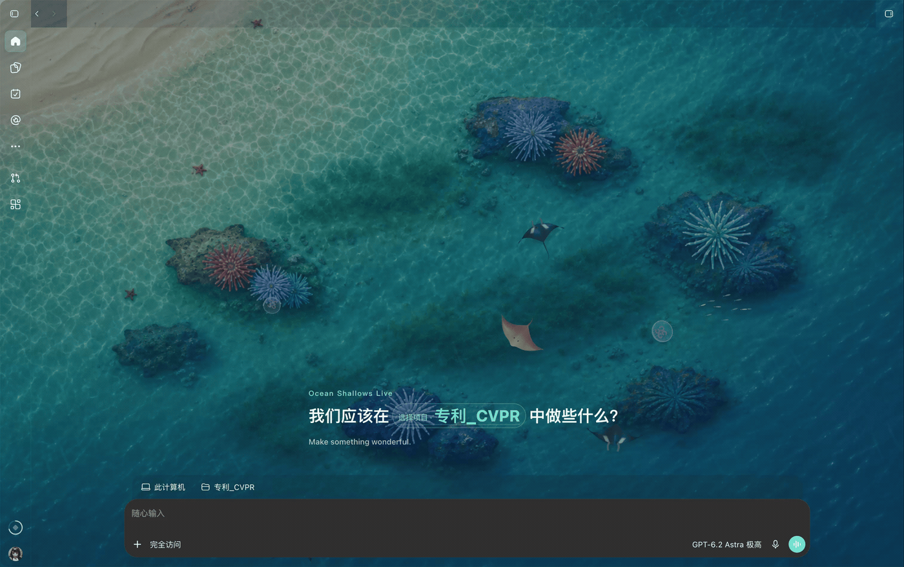

# Ocean Shallows Live

用于 Codex 桌面聊天窗口的动态浅海背景，基于 Codex Dream Skin 1.5.21。选中 **Ocean Shallows Live** 后，海面会流动，鱼群会自动出现，鼠标和键盘仍用于聊天。

macOS 已完成本机运行验证。Windows 提供对应的样式资源和部署流程，安装时需在目标电脑验证实际显示。

| 文件 | 用途 |
| --- | --- |
| [macOS App](app/Codex-Dream-Skin-1.5.21-macOS.zip) | Codex Dream Skin 1.5.21，支持 Apple Silicon 和 Intel。 |
| [Windows 安装流程](docs/windows.md) | Windows 10 / 11 x64 的安装、文件位置、启用、验证和回退。 |
| [海景主题](themes/preset-ocean-shallows/) | 主题配置、配色和海床底图。 |
| [renderer-inject.js](assets/renderer-inject.js) | macOS 和 Windows 共用的海景渲染文件。 |
| [macOS 样式](assets/dream-skin.css) | 海景图层、透明消息框和窗口失焦时的背景修正。 |
| [Windows 样式](assets/windows/dream-skin.css) | 同一海景样式加上 Windows 窗口和输入框适配。 |
| [海景定制技能](skills/codex-ocean-theme/SKILL.md) | 从单文件 HTML 预览开始调整效果，定稿后同步到聊天窗口，也可用于换机和回退。 |

## 在 Windows 上使用

先按 Windows 文档安装上游 Windows 引擎，再复制本仓库的海景渲染文件、Windows 样式和预设目录，最后从托盘选择 **Ocean Shallows Live**。Windows 的引擎资源位于 `%LOCALAPPDATA%\CodexDreamSkin\engine\assets\`，主题库位于 `%LOCALAPPDATA%\CodexDreamSkin\themes\`。[完整 Windows 步骤](docs/windows.md)

## 在另一台 Mac 上使用

1. 解压 App，移入「应用程序」并打开。首次使用 Dream Skin 时，在菜单栏选择「安装 / 升级引擎…」，完成 1.5.21 引擎安装。
2. 在 Finder 中按 ⇧⌘G，前往 `~/.codex/codex-dream-skin-studio/assets/`。先把现有的 `renderer-inject.js` 和 `dream-skin.css` 备份到其他目录，再用仓库 `assets/` 中的同名文件替换。
3. 前往 `~/Library/Application Support/CodexDreamSkinStudio/themes/`，把仓库中的整个 `preset-ocean-shallows` 文件夹放进去。确认 `theme.json` 和 `background.webp` 都直接位于这个文件夹中。
4. 打开 Dream Skin 菜单，在「已保存的主题」中选择 **Ocean Shallows Live**。

App 压缩包保留了 1.5.21 的出厂资源。修复或重装引擎后，如果能看到海床却没有鱼群，请重新核对第 2 步的两个文件。

## 切换主题时的行为

两个渲染文件由所有主题共用。只有主题 ID 为 `preset-ocean-shallows` 时，引擎才会创建海景画布、绘制水面并生成鱼群。切换到其他主题时，海景动画和画布会一起移除。切换到其他 App 时保持海景可见的样式，也只在海景图层存在时生效。

通用的标题栏识别和浅色输入框样式会在其他匹配的主题中生效。

## 来源

菜单栏 App 来自 [Codex Dream Skin v1.5.21](https://github.com/Fei-Away/Codex-Dream-Skin/releases/tag/v1.5.21)。上游软件许可证见 [LICENSE](LICENSE)，随 App 分发的第三方素材说明位于应用包内的 `Contents/Resources/NOTICE.md`。
