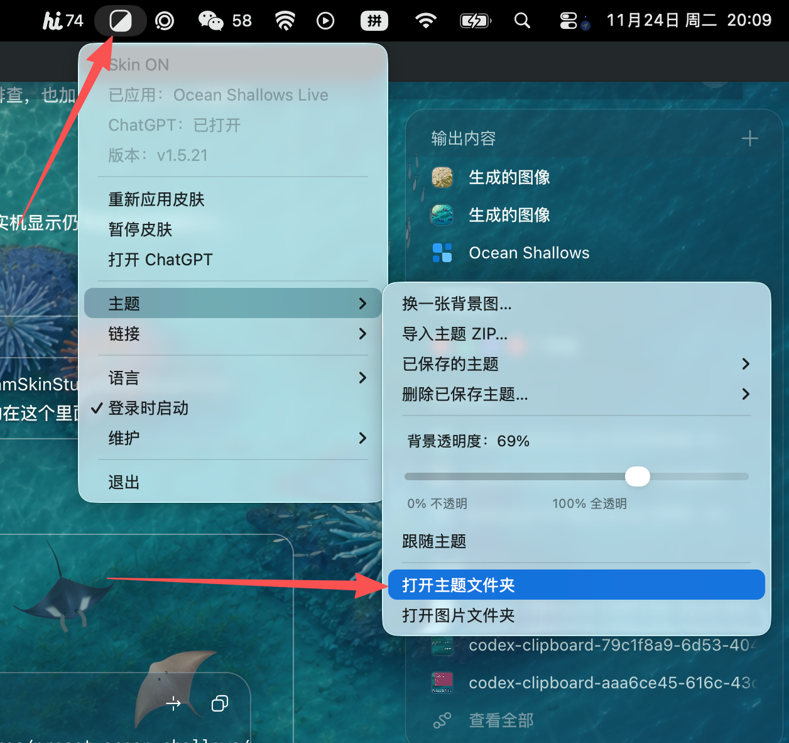

# Ocean Shallows Live

用于 Codex 桌面聊天窗口的动态浅海背景，基于 Codex Dream Skin 1.5.21。选中 **Ocean Shallows Live** 后，海面会流动，鱼群会自动出现，聊天控件保留优先级，空白海面支持点击互动。

海景资源 **v1.1.2** 修复海豚入水时突然消失：水下轮廓随深度渐变，并平滑接回正常游姿。保留抬头破水、弓背转体及出入水水花。[下载 macOS / Windows 资源包](https://github.com/Asyou-GD/codex_ocean/releases/tag/v1.1.2)

macOS 已有海景运行记录。新版交互已通过两套平台资源的浏览器测试，原生 Codex 窗口中的点击效果仍需实机确认。Windows 的安装与显示需在目标电脑验证。


| 文件 | 用途 |
| --- | --- |
| [macOS App](app/Codex-Dream-Skin-1.5.21-macOS.zip) | Codex Dream Skin 1.5.21，支持 Apple Silicon 和 Intel。 |
| [Windows 安装流程](docs/windows.md) | Windows 10 / 11 x64 的安装、文件位置、启用、验证和回退。 |
| [海景主题](themes/preset-ocean-shallows/) | 主题配置、配色和海床底图。 |
| [renderer-inject.js](assets/renderer-inject.js) | macOS 和 Windows 共用的海景渲染文件。 |
| [macOS 样式](assets/dream-skin.css) | 海景图层、透明消息框和窗口失焦时的背景修正。 |
| [Windows 样式](assets/windows/dream-skin.css) | 同一海景样式加上 Windows 窗口和输入框适配。 |
| [海景定制技能](skills/codex-ocean-theme/SKILL.md) | 从单文件 HTML 预览开始调整效果，定稿后同步到聊天窗口，也可用于换机和回退。 |

## 在 Windows 上使用

安装上游 Windows 引擎后，右键任务栏托盘里的 Dream Skin 图标，选择「打开主题文件夹」，将整个 `preset-ocean-shallows` 文件夹放进去。再把配套 JavaScript 和 Windows 样式放进当前引擎的 `assets` 目录，从「已保存主题」选择 **Ocean Shallows Live**。[完整 Windows 步骤](docs/windows.md)

## 在另一台 Mac 上使用

1. 解压 App，移入「应用程序」并打开。首次使用 Dream Skin 时，在菜单栏选择「安装 / 升级引擎…」，完成 1.5.21 引擎安装。
2. 点击菜单栏里的 Dream Skin 图标，选择「主题 → 打开主题文件夹」，将仓库中的整个 `preset-ocean-shallows` 文件夹放进去。
3. 找到当前 Dream Skin 引擎的 `assets` 目录，备份原有的 `renderer-inject.js` 和 `dream-skin.css`，再用仓库 `assets/` 中的同名文件替换。目录定位方法见下方说明。
4. 回到 Dream Skin 的「主题 → 已保存的主题」，选择 **Ocean Shallows Live**。

App 压缩包保留了 1.5.21 的出厂资源。修复或重装引擎后，如果能看到海床却没有鱼群，请重新核对第 3 步的两个文件。

## 找到软件实际使用的文件夹

主题文件夹以 Dream Skin 的「打开主题文件夹」菜单实际打开的位置为准。更换电脑、用户名或安装位置后，重新从菜单打开即可。

macOS 在菜单栏的「主题」子菜单里打开，Windows 在任务栏托盘菜单里打开。下图使用用户提供的 macOS 实际菜单截图。



复制后应能看到这样的结构

```text
软件打开的主题文件夹/
  preset-ocean-shallows/
    theme.json
    background.webp
```

需要核对以下内容

- `theme.json` 的 `id` 保持为 `preset-ocean-shallows`，`image` 与实际底图文件名一致。
- `renderer-inject.js` 和目标平台的 `dream-skin.css` 使用同一仓库版本，放进当前引擎读取的同一个 `assets` 目录。
- 修改过安装位置时，先根据实际启动入口找到引擎，再替换其中的文件。

<details>
<summary>引擎定位与 1.5.21 默认目录参考</summary>

Windows 1.5.21 中，从软件打开的主题文件夹返回上一层，进入 `engine → assets`。引擎目录同层应有 `VERSION` 和 `scripts`。使用自行修改的安装时，再根据正在运行的 Dream Skin 脚本位置确认引擎。

安装器创建的快捷方式可能指向 `setup-bootstrap.ps1`，它会继续启动用户数据目录中的引擎。定位资源时沿用软件打开的目录，并核对实际引擎。

macOS 1.5.21 的菜单栏 App 使用用户主目录下的 `.codex/codex-dream-skin-studio` 引擎。可在 Finder 用 ⇧⌘G 打开下表中的默认引擎目录。使用自行修改的 App 时，核对其实际启动脚本的位置。

| 平台 | 默认主题文件夹 | 默认引擎资源目录 |
| --- | --- | --- |
| macOS | `~/Library/Application Support/CodexDreamSkinStudio/themes/` | `~/.codex/codex-dream-skin-studio/assets/` |
| Windows | `%LOCALAPPDATA%\CodexDreamSkin\themes\` | `%LOCALAPPDATA%\CodexDreamSkin\engine\assets\` |

这些是 1.5.21 的默认路径，供定位和排查时参考。实际复制位置以软件菜单和启动入口为准。

</details>

## 点击海面和海豚

- 在聊天面板之间露出的海面上点击粉色海豚，它会先抬头破水，身体弓背转体后头先入水，带出水花和一圈圈涟漪。
- 点击空白水面，会出现小水花与扩散波纹；沙滩不会产生水纹。
- 消息框、输入框、侧栏、标题栏、链接、按钮和浮层内的点击留给 Codex。海豚游到消息框下面时，消息框优先。
- 拖动、选字、滚动和键盘操作照常使用。连续点击正在起跳的海豚不会重置这次动作。

## 切换主题时的行为

两个渲染文件由所有主题共用。只有主题 ID 为 `preset-ocean-shallows` 时，引擎才会创建海景画布、绘制水面并生成鱼群。切换到其他主题时，海景动画、画布和指针监听会一起移除。切换到其他 App 时保持海景可见的样式，也只在海景图层存在时生效。

通用的标题栏识别和浅色输入框样式会在其他匹配的主题中生效。

## 来源

菜单栏 App 来自 [Codex Dream Skin v1.5.21](https://github.com/Fei-Away/Codex-Dream-Skin/releases/tag/v1.5.21)。上游软件许可证见 [LICENSE](LICENSE)，随 App 分发的第三方素材说明位于应用包内的 `Contents/Resources/NOTICE.md`。
