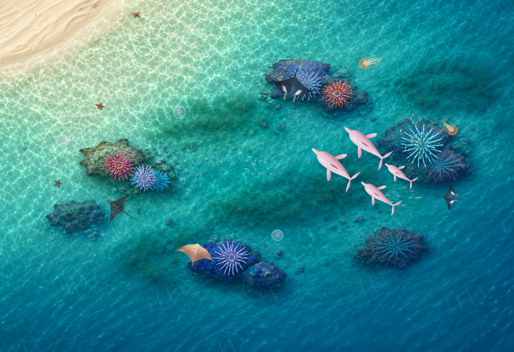

# Ocean Shallows v1.0.0

本次更新加入四只结伴游动的粉色海豚，并增强海面的流动焦散、长涌浪和细碎反光。海豚会摆动尾鳍，大小个体保持松散队形，沿开阔水域游动。

macOS 和 Windows 使用同一份海景 JavaScript，分别配套各自的样式。海景只播放动画，鼠标和键盘继续用于聊天。

## 下载

- `Ocean-Shallows-v1.0.0-macOS.zip` 供 macOS 使用。
- `Ocean-Shallows-v1.0.0-Windows.zip` 供 Windows 使用。
- `SHA256SUMS.txt` 提供两个压缩包的 SHA-256。

## 更新已有海景

1. 解压对应平台的资源包。
2. 备份当前引擎的 `renderer-inject.js` 和 `dream-skin.css`。
3. 将包内配套的 JavaScript、对应平台的 CSS 复制到当前引擎的同一个 `assets` 目录。Windows 使用包内的 `assets/windows/dream-skin.css`，复制到引擎时文件名为 `dream-skin.css`。
4. 从 Dream Skin 菜单重新应用 **Ocean Shallows Live**。

## 首次安装

先安装对应平台的 Dream Skin 1.5.21 引擎，再同步上述两份资源。从软件菜单选择「打开主题文件夹」，把包内的整个 `themes/preset-ocean-shallows` 目录放进去，在「已保存主题」选择 **Ocean Shallows Live**。

菜单定位方式、Windows 具体步骤和回退方法见仓库说明。[菜单与目录定位](https://github.com/Asyou-GD/codex_ocean/tree/v1.0.0#找到软件实际使用的文件夹) · [Windows 安装步骤](https://github.com/Asyou-GD/codex_ocean/blob/v1.0.0/docs/windows.md)

本次版本号对应海景资源。仓库中原版 Dream Skin App 的版本为 1.5.21。

## 已验证范围

macOS 已在本机 Codex 窗口完成应用和可见效果检查。两套平台资源均通过浏览器中的海豚泳姿、海面动画、聊天操作、Retina 缩放、GPU 恢复和主题切换检查。

Windows 桌面客户端的实际显示仍需在目标电脑验证。
